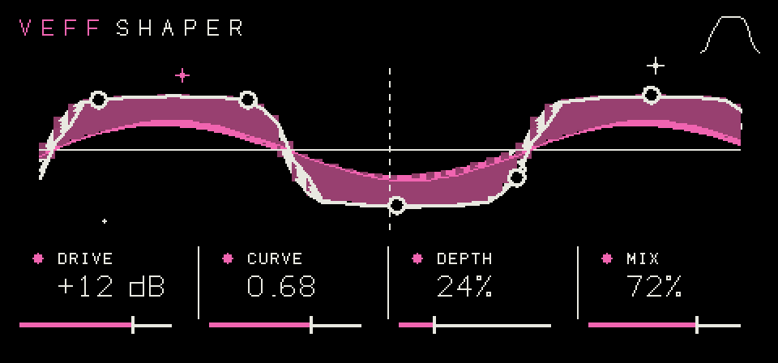

# Veff packs for open-field

Effects for the OP-1 Field, as packs for [open-field](https://github.com/LaP0573/open-field) (OS 1.7.3, base 30, level 10).

- Each effect appears in the unit's own lists of effects: shift and T3 on a sound, and the master's list on the mixer.
- Each effect also appears on every wagon of fx train.
- Every pack paints the same animated Veff page: a picture that moves with the values and the sound, and four columns with sliders.

Not affiliated with Teenage Engineering or Ableton.

Cycles are per block (64 frames, stereo), measured on a unit. The effect limit is 84,000.

| Pack | What it is | Stands on | Cycles | File |
| --- | --- | --- | --- | --- |
| veffbode | A Bode frequency shifter inside a delay's feedback loop. Knobs: shift, phase, feedback, mix. With shift held: delay (note or ms), sideband, tone, smear, cross. Starts as a jet flanger. | `delay` | ~59,000-65,000 average | [`veffbode.pack`](veffbode.pack) |
| veffrosion | A degrader in the spirit of Erosion: a 0.5 ms delay wobbled by a sine or band-passed noise. Knobs: freq, width, amount, mix. With shift held: mode (sine, noise, wide), tone. | `delay` | ~21,000 average | [`veffrosion.pack`](veffrosion.pack) |
| veffshaper | A parametric waveshaper. Knobs: drive, curve, depth, mix. With shift held: lin, damp, period, output. | `punch` | ~27,000-33,000 average | [`veffshaper.pack`](veffshaper.pack) |
| veffurator | A saturator, 2x oversampled. Knobs: drive, type (analog, sine, medium, hard, fold, digital), output, mix. With shift held: color, freq, clip, dc. | `punch` | ~54,000 average | [`veffurator.pack`](veffurator.pack) |
| veffrrrr | A two-stage distortion in serial routing. Knobs: drive, s1, s2, mix. With shift held: four sub-pages (s1, s2, fb, out); shift and a press of the 1st knob steps between them. Mix starts at 15%. | `nitro` | ~61,000-65,000 average; 82,000-86,000 at heavy settings (a cheaper version is in progress) | [`veffrrrr.pack`](veffrrrr.pack) |
| veffgraindelay | A grain delay in the spirit of Grain Delay: grains read from a stereo delay line, each with its own place and pitch. Knobs: pitch, spray, feedback, mix. With shift held: delay (note or ms), freq, random, spread, reverse. Starts as an octave-up shimmer on the eighth note. **Not yet tried on a unit.** | `delay` | estimate, not measured: ~30,000-43,000; worst ~53,000 (declared 56,000) | [`veffgraindelay.pack`](veffgraindelay.pack) |

## Controls

Every effect uses the four knobs: blue, ochre, grey and red, in that order. Holding shift turns the knobs to a second set of values, which the sound keeps when you save it. The page always shows the set you are turning; on the shift set, a pink tag next to the title says so.

### veffbode

| | Blue | Ochre | Grey | Red |
| --- | --- | --- | --- | --- |
| Knobs | shift (-2000..+2000 Hz, fine near 0) | phase (0..359°) | feedback (0..90) | mix |
| Shift held | delay (2/1..1/64 of the tempo, then 0..1000 ms) | sideband (down, both, up) | tone (the loop's low-pass) | smear (all-passes in the loop) |

- A press of the 1st knob sets shift to 0, the 2nd sets phase to 0, the 4th resets mix.
- Shift and a press of the 4th knob toggles **cross**: left and right are swapped in the loop.

### veffrosion

| | Blue | Ochre | Grey | Red |
| --- | --- | --- | --- | --- |
| Knobs | freq (30 Hz..18 kHz) | width (the noise's band) | amount (the depth of the wobble) | mix |
| Shift held | mode (sine, noise, wide) | tone (a low-pass on the grit) | | |

- A press of the 1st knob sets freq back to 1 kHz, the 4th sets mix to 0.

### veffshaper

| | Blue | Ochre | Grey | Red |
| --- | --- | --- | --- | --- |
| Knobs | drive (-12..+24 dB) | curve (a saturating cubic) | depth (a sine ripple along the curve) | mix |
| Shift held | lin (the linear part) | damp (flattens near zero) | period (the ripple's cycles) | output (0..-24 dB) |

- A press of a knob resets it: drive to 0 dB, curve and depth to 0, mix to 100.
- With shift, a press resets that value to its start.

### veffurator

| | Blue | Ochre | Grey | Red |
| --- | --- | --- | --- | --- |
| Knobs | drive (-36..+36 dB) | type (analog, sine, medium, hard, fold, digital) | output (-36..0 dB) | mix |
| Shift held | color (a peak before the shaper, -100..+100) | freq (the colour's 100 Hz..10 kHz) | clip (a soft clip on the output) | dc (the DC filter) |

- A press of the 1st knob sets drive to 0 dB, the 3rd sets output.
- With shift, a press of the 1st, 3rd or 4th knob switches color, clip or dc off and on.

### veffrrrr

The signal runs drive and tilt → stage 1 → stage 2 → output, with a feedback loop back to the input. Each stage is a shaper followed by a filter.

| | Blue | Ochre | Grey | Red |
| --- | --- | --- | --- | --- |
| Knobs | drive (0..36 dB) | s1 (stage 1 amount) | s2 (stage 2 amount) | mix (starts at 15%) |

With shift held there are **four pages**. **Shift and a press of the 1st knob steps to the next page**: s1 → s2 → fb → out → s1. The page's name is shown next to the title.

| Page | Blue | Ochre | Grey | Red |
| --- | --- | --- | --- | --- |
| `S1` (stage 1) | shape (sine, diode, fold, rect, crush, noise) | bias (-50..50) | filter (lp, bp, hp, comb) | freq (30 Hz..18 kHz) |
| `S2` (stage 2) | the same for stage 2 | | | |
| `FB` (feedback) | amount (0..100) | time (1/2..1/64 of the tempo, then 1..1000 ms) | lp (the loop's low-pass) | tone (the input's tilt, dark..bright) |
| `OUT` | out (-24..+12 dB) | | | |

- On `S1` and `S2`, shift and a press of the 4th knob steps the filter's resonance (r0..r7).
- A press of a knob without shift puts its value back to the start.
- The feedback only sings while sound comes in. A gate closes it about 0.4 s after the input goes quiet, so it never runs away.

### veffgraindelay

Not yet tried on a unit: built and tested on a computer only.

Incoming sound goes into a stereo delay line (2.97 s). Grains read from it: a new grain starts every 1/freq and lasts
two of those, so two always overlap and their smooth windows add up to one. Each grain gets, when it starts, its own
read place (delay back, plus a random part of spray), its own pitch (pitch plus a random part of random), a random
side (spread) and a direction (reverse). The grains' sum is the wet, and goes back into the line through a soft knee,
times feedback.

| | Blue | Ochre | Grey | Red |
| --- | --- | --- | --- | --- |
| Knobs | pitch (-24..+24 semitones, fine near 0) | spray (0..500 ms) | feedback (0..95) | mix |
| Shift held | delay (2/1..1/64 of the tempo, then 0..1000 ms) | freq (the grain rate, 1..150 Hz) | random (random pitch, up to ±12 semitones) | spread (each grain's random side) |

- Starts at pitch +12, spray 15 ms, feedback 45, mix 35; delay 1/8, freq 14.9 Hz, random 0, spread 40.
- A press of the 1st knob sets pitch to 0, the 2nd sets spray to 0, the 3rd and 4th put feedback and mix back to the start.
- With shift, a press of the 1st, 2nd or 3rd knob puts delay, freq or random back to the start.
- Shift and a press of the 4th knob toggles **reverse**: every grain is read backward. The page shows `rev`.
- A grain pitched up starts further back, so it never passes the write place: with pitch up the echo comes later than
  the delay. When a long grain at a high pitch would not fit in the line, the grains get shorter (a higher freq).
- The shortest delay is 2.9 ms (0 ms and 1 ms play as 2.9 ms).

## Pages

Rendered on a computer from each pack's own drawing code, at typical settings, scaled 2x.

**veffbode**


**veffrosion**


**veffshaper**



**veffurator**


**veffrrrr**


**veffgraindelay**


## Thumbnails

`thumbs/<name>.png`: each effect's shape alone, 300×240 with transparency, for the catalog. veffgraindelay has none yet.

## Install

Pick a pack on the open-field install page, or copy its `.pack` into the unit's `packs` folder beside `base.pack`.

## Build

Each folder builds inside an open-field 0.12 checkout, placed at `veff/<name>/`. For example:

```bash
python3 -I tools/pack_build.py build3 --recipe veff/veffbode/recipe.json --profile profiles/op1f-1.7.3.json --out veffbode.pack
python3 -I tools/pack_build.py check --pack veffbode.pack
```

What else is in the folders:
- `veff_ui.h` is the shared page: layout, stroke font and icons. It is the same in every folder, so each pack builds on its own.
- `<name>.svg.make` is a plain black page. It stands in for the base's effect page, so the pack paints the whole screen.
- The table generators (`make_tables.py`, `gen_tables.py`) write the `*_tables.h` files.
- `veffgraindelay/tests/` holds a host test of the sound and the page, built with the address and undefined-behaviour
  sanitizers. From the open-field checkout, with the folder at `veff/veffgraindelay/`:

```bash
sh veff/veffgraindelay/tests/run_tests.sh /tmp/veffgraindelay-renders
```

  It checks the plain delay, the tempo sync, mix 0, silence, the tails at the most feedback, the grain edges and
  determinism, and writes WAV files of test sounds through several settings and the page as PNG into that folder.
