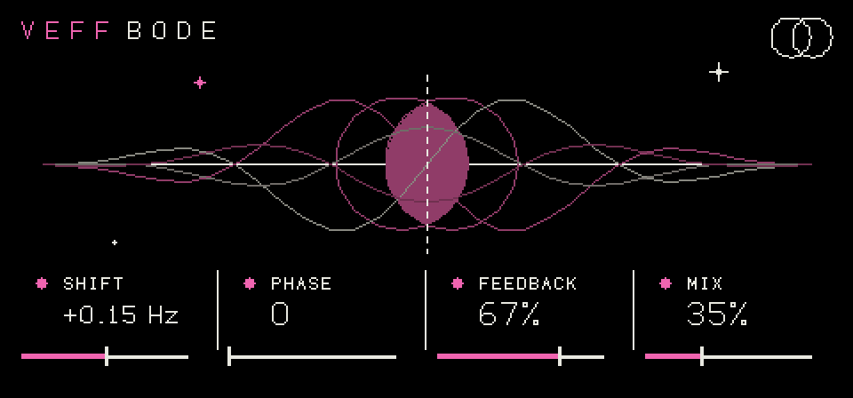
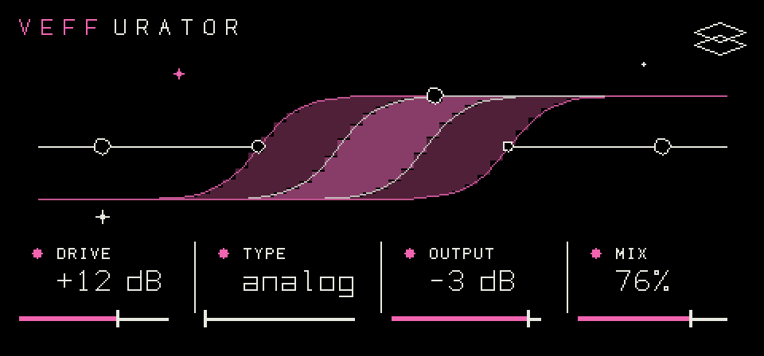
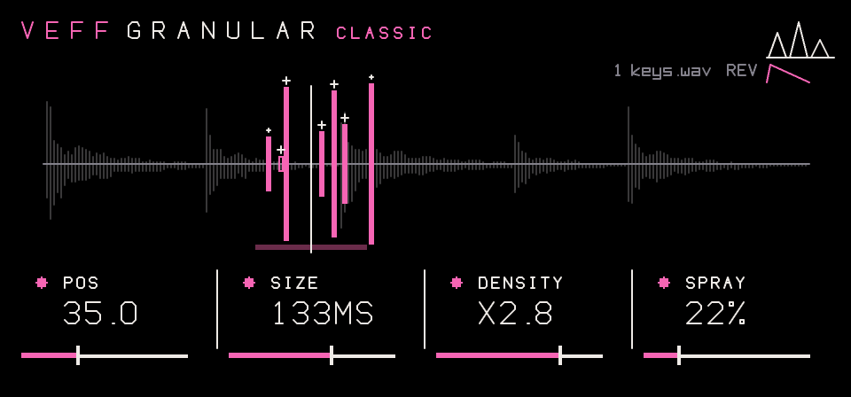

# Veff packs for open-field

Effects for the OP-1 Field, as packs for [open-field](https://github.com/LaP0573/open-field) (OS 1.7.3, level 10; veffgraindelay and veffgranular were built for open-field 0.14 and tried on base 37, release 0.19).

- Each effect appears in the unit's own lists of effects: shift and T3 on a sound, and the master's list on the mixer.
- Each effect also appears on every wagon of fx train.
- Every pack paints the same animated Veff page: a picture that moves with the values and the sound, and four columns with sliders.

Not affiliated with Teenage Engineering or Ableton.

Cycles are per block (64 frames, stereo), measured on a unit. The effect limit is 84,000.

| Pack | What it is | Stands on | Cycles | File |
| --- | --- | --- | --- | --- |
| veffbode | A Bode frequency shifter inside a delay's feedback loop. Knobs: shift, phase, feedback, mix. With shift held: delay (note or ms), sideband, tone, smear, cross. Starts as a jet flanger. | `delay` | ~59,000-65,000 average | [`veffbode.pack`](veffbode.pack) |
| veffrosion | A degrader in the spirit of Erosion: a 0.5 ms delay wobbled by a sine or band-passed noise. Knobs: freq, width, amount, mix. With shift held: mode (sine, noise, wide), tone. | `delay` | ~21,000 average | [`veffrosion.pack`](veffrosion.pack) |
| veffshaper | A parametric waveshaper. Knobs: drive, curve, depth, mix. With shift held: lin, damp, period, output. | `punch` | ~27,000-33,000 average | [`veffshaper.pack`](veffshaper.pack) |
| veffurator | A saturator, 2x oversampled. Knobs: drive, type (analog, sine, medium, hard, fold, digital), output, mix. With shift held: color, freq, clip, dc. | `punch` | ~54,000 average | [`veffurator.pack`](veffurator.pack) |
| veffrrrr | A two-stage distortion in serial routing. Knobs: drive, s1, s2, mix. With shift held: four sub-pages (s1, s2, fb, out); shift and a press of the 1st knob steps between them. Mix starts at 15%. | `nitro` | ~61,000-65,000 average; 82,000-86,000 at heavy settings (a cheaper version is in progress) | [`veffrrrr.pack`](veffrrrr.pack) |
| veffgraindelay | A grain delay in the spirit of Grain Delay: grains read from a stereo delay line, each with its own place and pitch. Knobs: pitch, spray, feedback, mix. With shift held: delay (note or ms), freq, random, spread, reverse. Starts as an octave-up shimmer on the eighth note. | `delay` | ~23,000-26,000 average, 34,769 at most in a first session (declared 56,000) | [`veffgraindelay.pack`](veffgraindelay.pack) |

One engine too: **veffgranular**, a granular sample synth in the unit's list of engines ([below](#engine-veffgranular)). File: [`veffgranular.pack`](veffgranular.pack).

## Controls

Every effect uses the four knobs: blue, ochre, grey and red, in that order. Holding shift turns the knobs to a second set of values, which the sound keeps when you save it. The page always shows the set you are turning; on the shift set, a pink tag next to the title says so.

The pictures are rendered on a computer from each pack's own drawing code, at typical settings, scaled 2x.

### veffbode



| | Blue | Ochre | Grey | Red |
| --- | --- | --- | --- | --- |
| Knobs | shift (-2000..+2000 Hz, fine near 0) | phase (0..359°) | feedback (0..90) | mix |
| Shift held | delay (2/1..1/64 of the tempo, then 0..1000 ms) | sideband (down, both, up) | tone (the loop's low-pass) | smear (all-passes in the loop) |

- A press of the 1st knob sets shift to 0, the 2nd sets phase to 0, the 4th resets mix.
- Shift and a press of the 4th knob toggles **cross**: left and right are swapped in the loop.

### veffrosion


| | Blue | Ochre | Grey | Red |
| --- | --- | --- | --- | --- |
| Knobs | freq (30 Hz..18 kHz) | width (the noise's band) | amount (the depth of the wobble) | mix |
| Shift held | mode (sine, noise, wide) | tone (a low-pass on the grit) | | |

- A press of the 1st knob sets freq back to 1 kHz, the 4th sets mix to 0.

### veffshaper


| | Blue | Ochre | Grey | Red |
| --- | --- | --- | --- | --- |
| Knobs | drive (-12..+24 dB) | curve (a saturating cubic) | depth (a sine ripple along the curve) | mix |
| Shift held | lin (the linear part) | damp (flattens near zero) | period (the ripple's cycles) | output (0..-24 dB) |

- A press of a knob resets it: drive to 0 dB, curve and depth to 0, mix to 100.
- With shift, a press resets that value to its start.

### veffurator



| | Blue | Ochre | Grey | Red |
| --- | --- | --- | --- | --- |
| Knobs | drive (-36..+36 dB) | type (analog, sine, medium, hard, fold, digital) | output (-36..0 dB) | mix |
| Shift held | color (a peak before the shaper, -100..+100) | freq (the colour's 100 Hz..10 kHz) | clip (a soft clip on the output) | dc (the DC filter) |

- A press of the 1st knob sets drive to 0 dB, the 3rd sets output.
- With shift, a press of the 1st, 3rd or 4th knob switches color, clip or dc off and on.

### veffrrrr


The signal runs drive and tilt → stage 1 → stage 2 → output, with a feedback loop back to the input. Each stage is a shaper followed by a filter.

| | Blue | Ochre | Grey | Red |
| --- | --- | --- | --- | --- |
| Knobs | drive (0..36 dB) | s1 (stage 1 amount) | s2 (stage 2 amount) | mix (starts at 15%) |

With shift held there are **four pages**. **Shift and a press of the 1st knob steps to the next page**: s1 → s2 → fb → out → s1. The page's name is shown next to the title.

| Page | Blue | Ochre | Grey | Red |
| --- | --- | --- | --- | --- |
| `S1` (stage 1) | shape (sine, diode, fold, rect, crush, noise) | bias (-50..50) | filter (lp, bp, hp, comb) | freq (30 Hz..18 kHz) |
| `S2` (stage 2) | the same for stage 2 | | | |
| `FB` (feedback) | amount (0..100) | time (1/2..1/64 of the tempo, then 1..1000 ms) | lp (the loop's low-pass) | tone (the input's tilt, dark..bright) |
| `OUT` | out (-24..+12 dB) | | | |

- On `S1` and `S2`, shift and a press of the 4th knob steps the filter's resonance (r0..r7).
- A press of a knob without shift puts its value back to the start.
- The feedback only sings while sound comes in. A gate closes it about 0.4 s after the input goes quiet, so it never runs away.

### veffgraindelay


Tried on one unit (OS 1.7.3, open-field 0.19): it loads, shows in the lists and on a wagon, and its cost was measured over a short session. Its sound across the settings was checked on a computer.

Incoming sound goes into a stereo delay line (2.97 s). Grains read from it: a new grain starts every 1/freq and lasts
two of those, so two always overlap and their smooth windows add up to one. Each grain gets, when it starts, its own
read place (delay back, plus a random part of spray), its own pitch (pitch plus a random part of random), a random
side (spread) and a direction (reverse). The grains' sum is the wet, and goes back into the line through a soft knee,
times feedback.

| | Blue | Ochre | Grey | Red |
| --- | --- | --- | --- | --- |
| Knobs | pitch (-24..+24 semitones, fine near 0) | spray (0..500 ms) | feedback (0..95) | mix |
| Shift held | delay (2/1..1/64 of the tempo, then 0..1000 ms) | freq (the grain rate, 1..150 Hz) | random (random pitch, up to ±12 semitones) | spread (each grain's random side) |

- Starts at pitch +12, spray 15 ms, feedback 45, mix 35; delay 1/8, freq 14.9 Hz, random 0, spread 40.
- A press of the 1st knob sets pitch to 0, the 2nd sets spray to 0, the 3rd and 4th put feedback and mix back to the start.
- With shift, a press of the 1st, 2nd or 3rd knob puts delay, freq or random back to the start.
- Shift and a press of the 4th knob toggles **reverse**: every grain is read backward. The page shows `rev`.
- A grain pitched up starts further back, so it never passes the write place: with pitch up the echo comes later than
  the delay. When a long grain at a high pitch would not fit in the line, the grains get shorter (a higher freq).
- The shortest delay is 2.9 ms (0 ms and 1 ms play as 2.9 ms).

## Engine: veffgranular

**Drop a lifted cut on the engine's own page** (version 6, OS 1.7.3+0 only). Lift one track on the tape, open the engine's page (T1) and press drop: the pack calls the firmware's own import of the tape clipboard for that slot's sample, and the grains play the cut. The page says `DROPPING`, then `DROPPED`, or `NOTHING LIFTED`, or `DROP REFUSED` and a number (6: more than one track lifted; 7: the unit is busy with the clipboard; 8: a stereo cut longer than a never-used slot holds). Shift and drop is left to the unit. The call is behind a sum of the firmware's own bytes, so on any other firmware the key is left to the unit and nothing is called. It is made on the display thread, not on the firmware's own worker: on the one unit that tried it, it worked on slots that had held a sampler's sample and on slots that never had; it has not been tried on another unit, and it is not what the firmware's authors planned for. What was read, the risks and the log's lines: [`veffgranular/DROP.md`](veffgranular/DROP.md).



A granular sample synth, in the unit's own list of **engines** (shift and T1 on a synth sound), in the spirit of Granulator III. Each key plays grains of one sample, pitched from the note against the sample's root (C4 unless the file says otherwise). Stereo out, six voices, up to four grains a voice (three with a stereo sample). Built for open-field 0.14 (base level 10).

**What was tried on a unit** (one unit, OS 1.7.3, open-field 0.19): version 6 loads, the engine shows in the list and plays the synth sampler's sample of its slot, its page stands in, and drops on the page were made as described above. Version 1's cost of a render was measured with no sample loaded; with a sample, and for version 6, it is not measured yet. A probe pack confirmed where the synth sampler keeps each slot's sample. Version 4, an earlier build of the drop, hung the same unit at start twice; the cause was not found, and versions 5 and 6 bound the work done each frame. The grains' sound across the settings was tested on a computer.

**The way to work is the sampler's**: lift a cut from the tape and drop it in the sampler, record into it, or load a file, then switch the sound to `veffgranular` (shift and T1) and play that same sample as grains. The engine reads the sample the synth sampler holds for the sound's slot, in place. Where that sample lies was read in the firmware on a computer and confirmed by a probe pack on one unit. From version 2 this is the default; a slot with no sample falls back to a file from the pack's folder.

| Mode (press the 1st knob) | What the grains do |
| --- | --- |
| classic | start at the position (moved by scan), each pushed by a random spray |
| loop | follow a play head that loops a short region from the position: free (four grains long) or 1/16, 1/8, 1/4, 1/2, 1 or 2 bars of the tempo (press the 3rd knob) |
| cloud | as classic, but each grain's spacing, size, pitch and pan are random, and the spray is never under a sixteenth of the sample |

| | Blue | Ochre | Grey | Red |
| --- | --- | --- | --- | --- |
| Knobs | position (0..100% of the sample) | size (5 ms..1 s) | density (0.5..5 grains at once) | spray (0..2 s around the position) |
| Shift held (page A) | scan (-2x..+2x: the position travels through the sample, backwards below 0) | shape (-100 a pluck, 0 an even bell, +100 a swell with a sharp end) | tune (-24..+24 semitones) | reverse (0..100%: the chance that a grain plays backward) |
| Shift held, page B | spread (pan and a little detune between grains) | volume | pitch random (each grain up to ±12 semitones off) | level random (each grain quieter by a random part) |

- **Shift and a press of the 1st knob steps between the two shift pages**, A and B. The tag beside the title says `SHIFT A` or `SHIFT B`.
- Presses without shift: 1st the mode, 2nd puts shape back to 0, 3rd the loop's length, 4th the next file (1..8).
- With shift, a press of the 2nd, 3rd or 4th knob puts that page's value back: on A shape 0, tune 0, reverse 0; on B volume 80, pitch random 0, level random 0.
- Shape moves the top of each grain's window: at -100 it stands at 1/32 of the grain (an attack, then a long fall), at +100 at 31/32. A rise or a fall is never shorter than 16 frames, so no setting clicks. The grain's length does not change. The four stepped windows of version 1 are gone.
- The eight values of the knobs and of page A are the unit's own: it keeps them with the sound, and its LFOs can move them (shape and reverse too). Page B's four values, the mode, the loop length and the file number are kept with the sound by the pack (level 7, `veffgranular_set`); the LFOs do not reach those.
- **A sound saved with version 1.** Values 6 and 8 were spread and volume there and are shape and reverse now. A version 1 sound is recognised by its saved record, or, when it has none, by those two values standing exactly at version 1's starts (spread 30, volume 80); its spread and volume are then moved to page B, and shape and reverse start at 0. A version 1 sound whose spread or volume you changed and which has no record (you never pressed a knob on its page) cannot be told apart: it loads with a shape and a reverse made from its old spread and volume, and with spread 30 and volume 80. Set them once and save.
- The page draws the sample's overview, the position and the spray's reach, and every grain that sounds, as a pink stroke as tall as its window is open, moving as it plays; a grain that plays backward is drawn hollow. The tag beside the title is the mode, or the shift page while shift is held. Top right: the source, the loop's length (loop mode), `REV` when reverse is above 0, and a small drawing of the grain's shape.

### The sample from the synth sampler (the default)

1. On the synth sound you want, pick `sampler` (shift and T1) and give it a sample as always: drop a lifted cut, record, or load a sound.
2. Pick `veffgranular` on the same sound. The page's top right says `SAMPLER` and the slot's number, and the overview is the sample.
3. For new material go back to `sampler`, drop or record, and return.

- OS 1.7.3+0 only, read only. When a check fails (another firmware, an address that does not look right) the file source plays instead.
- Where the sample ends: after a drop on the engine's own page, exactly the frames that drop rendered; for a slot the sampler loaded from a file, what the sampler's own count says; for a slot never loaded that holds sound all the same (a drop or a recording on the sampler's page), the buffer up to its last frame that is not silent, found a little each frame (the page says `READING THE SAMPLER` for a moment). The sampler writes its count only when it loads a file, so a drop made on the sampler's own page over a loaded sample plays with the old sample's length.
- A slot whose buffer is silent says `SAMPLER n EMPTY: LIFT, THEN DROP HERE` (unless a file plays).
- To switch this source off and play files only, put a file named `sampler.off` (any content) in the folder `veffgranular`. A `sampler.on` left from version 1 does nothing.

What is not known or not yet possible:

- A drop on the engine's page is not marked for the unit as a change of the sound: after a restart the slot may hold what the sampler last loaded. A drop made on the sampler's own page over a loaded sample plays with the loaded sample's length.
- The pack writes one line in the log for each key that goes down while its page is up and that it does not take, with the key's number.

- The probe showed, on one unit, that a slot's sample stays in memory while another engine plays on that slot and comes back the same after the unit restarts.
- The sampler's own start, end and loop points and root note are not found yet: the engine uses all of what was dropped or recorded and C4 as the root. Use position and tune.
- The saved sound does not carry the sample: it is a `dsynth` sound with the engine's values. After a power cycle the slot holds whatever the sampler last loaded.
- The sampler rewrites its buffer in place while it records or takes a drop. The engine notices the change and fades its grains out and starts again, so expect a hole in the sound while that happens, not a fault.

### The sample from a file in the pack's folder (when the slot's sampler is empty, or with `sampler.off`)

1. Connect the unit in disk mode. Next to `synth`, `drum` and `tapes` there is a folder `veffgranular`.
2. Put a sample in it, named with its number first: `1.wav`, `2 pad.aif`, and so on, up to `8`. WAV or AIFF/AIFC (`NONE` or `sowt`), 16, 24 or 32-bit PCM, mono or stereo, 8 to 192 kHz. At most 4 MiB (about 47 s mono or 23 s stereo at 16-bit, 44.1 kHz). A `smpl` (WAV) or `INST` (AIFF) chunk sets the root note.
3. Leave disk mode. Each sound plays file 1 until you press the 4th knob to pick another. The file is read when a sound that plays the engine needs it, and again each time disk mode closes.

With no file, a file that isn't one of these, or no memory for it, the engine is silent and the page says why. Only one file is in memory at a time.

### Its own sounds

Four sounds come with the pack and show in the sound list after the next start, in a folder `veffgranular`: `pad`, `freeze`, `shards` and `scan`. They are settings of the eight values, envelopes and an effect only (page B and the mode start where every sound does): a sound file cannot carry a sample, so each plays whatever the slot's sampler holds.

### Cost

The unit's limit for an engine is 40,000 cycles a voice's render; veffgranular declares 40,000. Measured on a unit with no sample loaded only: 7,300 cycles on average and 13,432 at most, never over. With a sample it is **not measured yet**. The estimate from the compiled inner loop: about 60 instructions a grain-frame with a stereo sample (45 mono), plus the reads of the sample in the unit's main memory, so about 30,000-36,000 cycles a render at the grain cap (3 stereo or 4 mono grains through the whole block). The worst case is cloud or high density at a high note with a stereo sample: the grains read far apart and each read can miss the cache. If the log's `engine: 'veffgranular' this period:` line shows renders over the declared cost, lower `ACTIVE_MOST_STEREO` / `ACTIVE_MOST_MONO` in `granular_core.h`.

Version 2's shape, reverse and the two random values add nothing a frame that could be counted: the shape is one comparison a grain-frame (which of two steps the window takes), a reversed grain runs the same loop downward, and the random values act once, when a grain starts. In the code compiled for the unit the four grain loops are 60 to 77 instructions long, against 69 to 81 in version 1 (counted in the compiler's output, not measured). A tone filter a grain was left out because it would cost every frame.

### Tested on a computer

`sh veffgranular/tests/run_tests.sh <folder>` builds the DSP and the file reader (`granular_core.h`, `sample_file.h`, which call nothing of the unit's) with the address and undefined-behaviour sanitizers and runs them: renders of each mode as WAV files into the folder, the pitch of a 440 Hz sine at three notes and a tune, silence in and silence out, no grain left after a release, two renders alike, mono and stereo, samples of 2 to 1,000 frames, a region moved and a sample replaced under a held note, invalid sources, and the reader on good files, every cut of them and 20,000 random ones. Version 2 adds: single grains over a constant sample at every shape, size and direction (no step steeper than a 16-frame edge allows, the top where the shape puts it), overlapping grains keeping the even bell's level, 148 reversed runs with a region that is not at 0 (no read outside it), a reversed grain shown to read a ramp downward, and the sampler's region from the fields the probe printed.

## A drum engine: veffchop

veffchop 2 ran on a unit (base 40's drum's page, open-field 0.21): the page, the analysis and APPLY were tried and heard. Version 4 is a **drum engine** and needs **base 40 with the drum engine** (`op1f_drum_engine_1`, docs/drum-engine.md in open-field-catalog at drum-page); a base with only the drum's page of before (`op1f_drum_page_1`) leaves it out. Version 4 ran on a unit: the list loads a kit as it closes, which ended the ride (fixed in the base at ab28f1f); version 5 also waits out a kit's load before it judges mono. Version 5 has not run on a unit. It writes to the drum kit's memory (the 24 start and end points of the current slot), at addresses found with `veffdrumprobe` on OS 1.7.3 (`veffdrumprobe/FINDINGS.md`, sections 6 and 7). It is for OS 1.7.3 only.

[`veffchop.pack`](veffchop.pack) chops the current drum kit's sample into the 24 drum keys. From version 4 it is a drum engine, as `veffgranular` is a synth engine: in the **drum** mode, shift and **T1** opens the drum's engine list, where `veffchop` stands among `dbox` and the drum sampler. Pick it on a drum sound that plays the drum sampler: the sound goes on playing the drum sampler with its kit as it was, and **T1** shows veffchop's page in place of the sampler's own. Picked on a `dbox` sound nothing changes (the log says to pick the drum sampler there first). Picking the drum sampler (a kit) or `dbox` there again brings the unit's own page back. The drum sound's file keeps the pick (`op1f_engine`), so a saved kit comes back on veffchop; without the pack, or on stock firmware, it loads as the plain drum sampler kit. It plays nothing itself; every key goes through to the kit, and the page shows which slice the key plays.

The page: the whole sample's wave, a white line at every cut with the slice's number over it, the lines moving as soon as a knob turns. Under the wave a strip of the 24 keys, each with its slice's number and colour (`-` dark: the key keeps the kit's own points). A key struck lights its cell and its slice, and a pink marker runs across the slice at 44.1 frames a millisecond (the key's pitch not counted). The tag after the title says how many slices, `ANALYSING n%`, or why nothing can be chopped.

| Knob | Turn | Press | With shift: turn | With shift: press |
| --- | --- | --- | --- | --- |
| 1 (blue) | MODE: TRANSIENT, LAZY, EQUAL | | OFFSET 0..20 ms (cuts moved earlier) | |
| 2 | SENS 0..100 (transient, lazy) or PARTS 2..24 (equal) | | GAP 20..500 ms (lazy: closer cuts merged) | |
| 3 | MAP: ORDER, WRAP, KIT, KIT+WRAP | | | |
| 4 | | APPLY: writes the 24 points | | UNDO: the kit's own points back |

- **TRANSIENT**: the onsets at least as strong as SENSITIVITY asks (the strongest 23 when more pass), cut about 1.5 ms before the first loud frame. **EQUAL**: N equal parts.
- **LAZY** (v7, as on the OP-1 and the OP-XY): turn knob 1 to LAZY and **press knob 1** (ARM): veffchop keeps the kit's own points and makes key 1 (the lowest F) the whole sample. **Play key 1** (hold it if the key's play mode stops at the key's release): the sample plays through and a pink line runs along the wave. **Tap any other key**, or press knob 2, at each place a slice should start: a cut appears there (on the nearest zero crossing; at least 20 ms apart; up to 23). The tapped keys are taken while key 1 plays, so only key 1 sounds. Shift and knob 4's press clears the taps; knob 1's press again disarms and puts the kit's own points back. **Press knob 4** (APPLY) to write the slices (the first from the sample's start, each to the next tap) onto the keys by MAP; key 1 then gets its slice. Shift and knob 4 afterwards is UNDO as before. veffchop does not change any key's play mode.
- **ORDER**: slice 1 on key 1 and on. **KIT**: onto the stock layout: the two strongest low slices on keys 1-2 (kick), the two brightest on 9 and 11 (hats), the strongest of the middle ones on 3-4 (snare), the rest in order. **WRAP** fills keys past the last slice from slice 1 again; without it those keys keep the kit's own points.
- The sample is read once, when it changed and then stayed put for half a second: 4096 words a frame at most (about 4 s for the longest), on the display thread. The knobs only filter what that reading found.
- APPLY writes only +4 (start) and +8 (end) of the current slot's 24 key records, in one frame, start first only where that keeps every start before its end; at least `0x00100000` between them. The kit's own 48 words are kept at the first apply to a sample; shift and the fourth knob's press writes them back. Pitch, mode, pan and volume are never touched.
- A kit being loaded is judged only once its words and its stereo byte stayed put for half a second (v5): the unit showed a stereo kit's words with the stereo byte still 0 during a load, and words 8 for a moment.
- **Mono samples** are chopped too (v6): their points are fractions of the mono capacity, 529,200 frames.
- **Drop** (v6): lift a cut on the tape, then the drop key on veffchop's page: veffchop asks the base (`op1f_sample_drop`, base 40 at 3914b2f) and the unit drops the cut into that drum sound's sample as the drum sampler's page does; veffchop then analyses it again (`N SLICES`); press the fourth knob to apply. `veffchop/DROP.md` says what the log shows. Not tried on a unit.
- Refused: a slot past 8, an address out of range, a stereo byte other than 0/1, a sample under 0.1 s, a sample still loading.
- Lines in the log: `veffchop: start` (the first line of its first frame, which does nothing else), `slot n: ... analysing`, `slot n analysed in ... frames: ... candidates`, `applied to slot n: ...` with four lines `keys a-b start-end ...`, `undo on slot n`, `not chopping: ...`; `drum engine page up/off`; and the base's `drum: 'veffchop' of 'veffchop' rides the drum sampler, entry 32 of the drum's engine list`, `drum: drum n rides 'veffchop'`, `page: 'veffchop' stands in for the drum engine's page of drum n, ...`, `keyboard key n struck, taken as drum key k`, `4th knob pressed: shift flag .., down-shift .., shift held ..`.
- **Coming from v1**: v1 was a sequencer, and the drum may still name it as its sequencer; the unit then writes `E seqids: unknown sequencer name: 'veffchop'` at the start. It is harmless: choose another sequencer for the drum once, and the line goes.
- Shift is seen by its own key (38) as well as by the press's flag (v3), since on the unit the knob's press came with no shift flag.
- Whether a stock save of the kit keeps the new points is not known (FINDINGS section 7).

Tests on a computer, under the address and undefined-behaviour sanitizers (`OPEN_FIELD=<open-field-catalog at drum-page, base 40's drum engine> sh veffchop/tests/run_tests.sh <folder>`): the Q31 conversion exact for every frame, onsets on synthetic drum loops with known hits, lazy cuts on zero crossings, equal parts, the mappings, the order of the writes, undo, the refusals, the budget of words a frame; and the page as pictures. `veffchop/tests/build_pack.sh` builds the pack and refuses one that needs a name other than open-field's; `veffchop/tests/recipe_check.py` (run by it) holds the recipe and the pack to the drum engine's ask and its mark.

## Thumbnails

`thumbs/<name>.png`: each pack's shape alone, 300×240 with transparency, for the catalog.

## Install

Pick a pack on the open-field install page, or copy its `.pack` into the unit's `packs` folder beside `base.pack`.

## Build

Each folder builds inside an open-field 0.12 checkout, placed at `veff/<name>/`. For example:

```bash
python3 -I tools/pack_build.py build3 --recipe veff/veffbode/recipe.json --profile profiles/op1f-1.7.3.json --out veffbode.pack
python3 -I tools/pack_build.py check --pack veffbode.pack
```

What else is in the folders:
- `veff_ui.h` is the shared page: layout, stroke font and icons. It is the same in every folder, so each pack builds on its own.
- `<name>.svg.make` is a plain black page. It stands in for the base's effect page, so the pack paints the whole screen.
- The table generators (`make_tables.py`, `gen_tables.py`) write the `*_tables.h` files.
- `veffgraindelay/tests/` holds a host test of the sound and the page, built with the address and undefined-behaviour
  sanitizers. From the open-field checkout, with the folder at `veff/veffgraindelay/`:

```bash
sh veff/veffgraindelay/tests/run_tests.sh /tmp/veffgraindelay-renders
```

  It checks the plain delay, the tempo sync, mix 0, silence, the tails at the most feedback, the grain edges and
  determinism, and writes WAV files of test sounds through several settings and the page as PNG into that folder.


`veffgranular` builds with `OPEN_FIELD=<an open-field 0.14 checkout> sh veffgranular/tests/build_pack.sh` (`gen_tables.py` writes `veffgranular_tables.h`). The script refuses a pack that needs any name but open-field's own (`op1f_...`): the unit has no C library, and a struct copied as a whole or a division can make the compiler call `memcpy`, `memset` or a libgcc routine, for which the loader leaves the pack out at the start ("nobody offers the name it needs"). `tools/pack_build.py check` prints such a name in its line `wants:` and does not fail. Version 5 was lost to this on a unit; version 6 needs `op1f_level_10`, `op1f_list`, `op1f_log`, `op1f_memory`, `op1f_page_stand_in`, `op1f_paint_box`, `op1f_paint_line`, `op1f_param_get`, `op1f_param_heard`, `op1f_param_set`, `op1f_read`, `op1f_riding`, `op1f_value_get`, `op1f_value_set` and nothing else.
