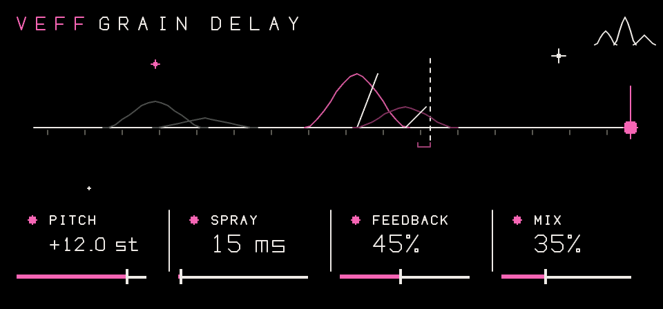

# Veff packs for open-field

Effects for the OP-1 Field, as packs for [open-field](https://github.com/LaP0573/open-field) (OS 1.7.3, level 10; veffgraindelay and veffgranular were built for open-field 0.14 and tried on base 37, release 0.19).

- Each effect appears in the unit's own lists of effects: shift and T3 on a sound, and the master's list on the mixer.
- Each effect also appears on every wagon of fx train.
- Every pack paints the same animated Veff page: a picture that moves with the values and the sound, and four columns with sliders.

Not affiliated with Teenage Engineering or Ableton.

Cycles are per block (64 frames, stereo), measured on a unit. The effect limit is 84,000.

| Pack | What it is | Stands on | Cycles | File |
| --- | --- | --- | --- | --- |
| veffbode | A Bode frequency shifter inside a delay's feedback loop. Knobs: shift, phase, feedback, mix. With shift held: delay (note or ms), sideband, tone, smear, cross. Starts as a jet flanger. | `delay` | ~59,000-65,000 average | [`veffbode.pack`](veffbode.pack) |
| veffrosion | A degrader in the spirit of Erosion: a 0.5 ms delay wobbled by a sine or band-passed noise. Knobs: freq, width, amount, mix. With shift held: mode (sine, noise, wide), tone. | `delay` | ~21,000 average | [`veffrosion.pack`](veffrosion.pack) |
| veffshaper | A parametric waveshaper. Knobs: drive, curve, depth, mix. With shift held: lin, damp, period, output. | `punch` | ~27,000-33,000 average | [`veffshaper.pack`](veffshaper.pack) |
| veffurator | A saturator, 2x oversampled. Knobs: drive, type (analog, sine, medium, hard, fold, digital), output, mix. With shift held: color, freq, clip, dc. | `punch` | ~54,000 average | [`veffurator.pack`](veffurator.pack) |
| veffrrrr | A two-stage distortion in serial routing. Knobs: drive, s1, s2, mix. With shift held: four sub-pages (s1, s2, fb, out); shift and a press of the 1st knob steps between them. Mix starts at 15%. | `nitro` | ~61,000-65,000 average; 82,000-86,000 at heavy settings (a cheaper version is in progress) | [`veffrrrr.pack`](veffrrrr.pack) |
| veffgraindelay | A grain delay in the spirit of Grain Delay: grains read from a stereo delay line, each with its own place and pitch. Knobs: pitch, spray, feedback, mix. With shift held: delay (note or ms), freq, random, spread, reverse. Starts as an octave-up shimmer on the eighth note. | `delay` | ~23,000-26,000 average, 34,769 at most in a first session (declared 56,000) | [`veffgraindelay.pack`](veffgraindelay.pack) |

One engine too: **veffgranular**, a granular sample synth in the unit's list of engines ([below](#engine-veffgranular)). File: [`veffgranular.pack`](veffgranular.pack).

## Controls

Every effect uses the four knobs: blue, ochre, grey and red, in that order. Holding shift turns the knobs to a second set of values, which the sound keeps when you save it. The page always shows the set you are turning; on the shift set, a pink tag next to the title says so.

The pictures are rendered on a computer from each pack's own drawing code, at typical settings, scaled 2x.

### veffbode


| | Blue | Ochre | Grey | Red |
| --- | --- | --- | --- | --- |
| Knobs | shift (-2000..+2000 Hz, fine near 0) | phase (0..359°) | feedback (0..90) | mix |
| Shift held | delay (2/1..1/64 of the tempo, then 0..1000 ms) | sideband (down, both, up) | tone (the loop's low-pass) | smear (all-passes in the loop) |

- A press of the 1st knob sets shift to 0, the 2nd sets phase to 0, the 4th resets mix.
- Shift and a press of the 4th knob toggles **cross**: left and right are swapped in the loop.

### veffrosion


| | Blue | Ochre | Grey | Red |
| --- | --- | --- | --- | --- |
| Knobs | freq (30 Hz..18 kHz) | width (the noise's band) | amount (the depth of the wobble) | mix |
| Shift held | mode (sine, noise, wide) | tone (a low-pass on the grit) | | |

- A press of the 1st knob sets freq back to 1 kHz, the 4th sets mix to 0.

### veffshaper


| | Blue | Ochre | Grey | Red |
| --- | --- | --- | --- | --- |
| Knobs | drive (-12..+24 dB) | curve (a saturating cubic) | depth (a sine ripple along the curve) | mix |
| Shift held | lin (the linear part) | damp (flattens near zero) | period (the ripple's cycles) | output (0..-24 dB) |

- A press of a knob resets it: drive to 0 dB, curve and depth to 0, mix to 100.
- With shift, a press resets that value to its start.

### veffurator


| | Blue | Ochre | Grey | Red |
| --- | --- | --- | --- | --- |
| Knobs | drive (-36..+36 dB) | type (analog, sine, medium, hard, fold, digital) | output (-36..0 dB) | mix |
| Shift held | color (a peak before the shaper, -100..+100) | freq (the colour's 100 Hz..10 kHz) | clip (a soft clip on the output) | dc (the DC filter) |

- A press of the 1st knob sets drive to 0 dB, the 3rd sets output.
- With shift, a press of the 1st, 3rd or 4th knob switches color, clip or dc off and on.

### veffrrrr


The signal runs drive and tilt → stage 1 → stage 2 → output, with a feedback loop back to the input. Each stage is a shaper followed by a filter.

| | Blue | Ochre | Grey | Red |
| --- | --- | --- | --- | --- |
| Knobs | drive (0..36 dB) | s1 (stage 1 amount) | s2 (stage 2 amount) | mix (starts at 15%) |

With shift held there are **four pages**. **Shift and a press of the 1st knob steps to the next page**: s1 → s2 → fb → out → s1. The page's name is shown next to the title.

| Page | Blue | Ochre | Grey | Red |
| --- | --- | --- | --- | --- |
| `S1` (stage 1) | shape (sine, diode, fold, rect, crush, noise) | bias (-50..50) | filter (lp, bp, hp, comb) | freq (30 Hz..18 kHz) |
| `S2` (stage 2) | the same for stage 2 | | | |
| `FB` (feedback) | amount (0..100) | time (1/2..1/64 of the tempo, then 1..1000 ms) | lp (the loop's low-pass) | tone (the input's tilt, dark..bright) |
| `OUT` | out (-24..+12 dB) | | | |

- On `S1` and `S2`, shift and a press of the 4th knob steps the filter's resonance (r0..r7).
- A press of a knob without shift puts its value back to the start.
- The feedback only sings while sound comes in. A gate closes it about 0.4 s after the input goes quiet, so it never runs away.

### veffgraindelay



Tried on one unit (OS 1.7.3, open-field 0.19): it loads, shows in the lists and on a wagon, and its cost was measured over a short session. Its sound across the settings was checked on a computer.

Incoming sound goes into a stereo delay line (2.97 s). Grains read from it: a new grain starts every 1/freq and lasts
two of those, so two always overlap and their smooth windows add up to one. Each grain gets, when it starts, its own
read place (delay back, plus a random part of spray), its own pitch (pitch plus a random part of random), a random
side (spread) and a direction (reverse). The grains' sum is the wet, and goes back into the line through a soft knee,
times feedback.

| | Blue | Ochre | Grey | Red |
| --- | --- | --- | --- | --- |
| Knobs | pitch (-24..+24 semitones, fine near 0) | spray (0..500 ms) | feedback (0..95) | mix |
| Shift held | delay (2/1..1/64 of the tempo, then 0..1000 ms) | freq (the grain rate, 1..150 Hz) | random (random pitch, up to ±12 semitones) | spread (each grain's random side) |

- Starts at pitch +12, spray 15 ms, feedback 45, mix 35; delay 1/8, freq 14.9 Hz, random 0, spread 40.
- A press of the 1st knob sets pitch to 0, the 2nd sets spray to 0, the 3rd and 4th put feedback and mix back to the start.
- With shift, a press of the 1st, 2nd or 3rd knob puts delay, freq or random back to the start.
- Shift and a press of the 4th knob toggles **reverse**: every grain is read backward. The page shows `rev`.
- A grain pitched up starts further back, so it never passes the write place: with pitch up the echo comes later than
  the delay. When a long grain at a high pitch would not fit in the line, the grains get shorter (a higher freq).
- The shortest delay is 2.9 ms (0 ms and 1 ms play as 2.9 ms).

## Engine: veffgranular


A granular sample synth, in the unit's own list of **engines** (shift and T1 on a synth sound), in the spirit of Granulator III. Each key plays grains of one sample, pitched from the note against the sample's root (C4 unless the file says otherwise). Stereo out, six voices, up to four grains a voice (three with a stereo sample). Built for open-field 0.14 (base level 10).

**Version 2 has not been tried on a unit.** What was tried is version 1 (one unit, OS 1.7.3, open-field 0.19): the pack loads, the engine shows in the list and plays, its page stands in, and the cost of a render was measured with no sample loaded. The probe pack confirmed where the synth sampler keeps each slot's sample. Playing a sampler's sample as grains has been switched on on that unit but not yet reported back; the sound of the grains was tested on a computer.

**The way to work is the sampler's**: lift a cut from the tape and drop it in the sampler, record into it, or load a file, then switch the sound to `veffgranular` (shift and T1) and play that same sample as grains. The engine reads the sample the synth sampler holds for the sound's slot, in place. Where that sample lies was read in the firmware on a computer and confirmed by a probe pack on one unit. From version 2 this is the default; a slot with no sample falls back to a file from the pack's folder.

| Mode (press the 1st knob) | What the grains do |
| --- | --- |
| classic | start at the position (moved by scan), each pushed by a random spray |
| loop | follow a play head that loops a short region from the position: free (four grains long) or 1/16, 1/8, 1/4, 1/2, 1 or 2 bars of the tempo (press the 3rd knob) |
| cloud | as classic, but each grain's spacing, size, pitch and pan are random, and the spray is never under a sixteenth of the sample |

| | Blue | Ochre | Grey | Red |
| --- | --- | --- | --- | --- |
| Knobs | position (0..100% of the sample) | size (5 ms..1 s) | density (0.5..5 grains at once) | spray (0..2 s around the position) |
| Shift held | scan (-2x..+2x: the position travels through the sample, backwards below 0) | spread (pan and a little detune between grains) | tune (-24..+24 semitones) | volume |

- Presses without shift: 1st the mode, 2nd the window (soft, flat, pluck, tri), 3rd the loop's length, 4th the next file (1..8).
- With shift, a press puts its value back: scan 0, spread 30, tune 0, volume 80.
- The eight knob values are kept by the unit with the sound. Mode, window, loop length and file number are kept with the sound too (level 7, `veffgranular_set`).
- The page draws the sample's overview, the position and the spray's reach, and every grain that sounds, as a pink stroke as tall as its window is open, moving as it plays. The tag beside the title is the mode, or `SHIFT` while shift is held. Top right: the source, the window and (loop) the loop's length.

### The sample from the synth sampler (the default)

1. On the synth sound you want, pick `sampler` (shift and T1) and give it a sample as always: drop a lifted cut, record, or load a sound.
2. Pick `veffgranular` on the same sound. The page's top right says `SAMPLER` and the slot's number, and the overview is the sample.
3. For new material go back to `sampler`, drop or record, and return.

- OS 1.7.3+0 only, read only. When a check fails (another firmware, an address that does not look right) the file source plays instead.
- The length is what the sampler says the last drop, recording or load wrote, so a short drop plays as a short sample, with nothing of an older sample behind it.
- A slot the sampler holds nothing in says `SAMPLER n EMPTY: DROP IN THE SAMPLER` (unless a file plays).
- To switch this source off and play files only, put a file named `sampler.off` (any content) in the folder `veffgranular`. A `sampler.on` left from version 1 does nothing.

What is not known or not yet possible:

- The probe showed, on one unit, that a slot's sample stays in memory while another engine plays on that slot and comes back the same after the unit restarts.
- The sampler's own start, end and loop points and root note are not found yet: the engine uses all of what was dropped or recorded and C4 as the root. Use position and tune.
- The saved sound does not carry the sample: it is a `dsynth` sound with the engine's values. After a power cycle the slot holds whatever the sampler last loaded.
- The sampler rewrites its buffer in place while it records or takes a drop. The engine notices the change and fades its grains out and starts again, so expect a hole in the sound while that happens, not a fault.

### The sample from a file in the pack's folder (when the slot's sampler is empty, or with `sampler.off`)

1. Connect the unit in disk mode. Next to `synth`, `drum` and `tapes` there is a folder `veffgranular`.
2. Put a sample in it, named with its number first: `1.wav`, `2 pad.aif`, and so on, up to `8`. WAV or AIFF/AIFC (`NONE` or `sowt`), 16, 24 or 32-bit PCM, mono or stereo, 8 to 192 kHz. At most 4 MiB (about 47 s mono or 23 s stereo at 16-bit, 44.1 kHz). A `smpl` (WAV) or `INST` (AIFF) chunk sets the root note.
3. Leave disk mode. Each sound plays file 1 until you press the 4th knob to pick another. The file is read when a sound that plays the engine needs it, and again each time disk mode closes.

With no file, a file that isn't one of these, or no memory for it, the engine is silent and the page says why. Only one file is in memory at a time.

### Its own sounds

Four sounds come with the pack and show in the sound list after the next start, in a folder `veffgranular`: `pad`, `freeze`, `shards` and `scan`. They are knob settings, envelopes and an effect only: a sound file cannot carry a sample, so each plays whatever the slot's sampler holds.

### Cost

The unit's limit for an engine is 40,000 cycles a voice's render; veffgranular declares 40,000. Measured on a unit with no sample loaded only: 7,300 cycles on average and 13,432 at most, never over. With a sample it is **not measured yet**. The estimate from the compiled inner loop: about 60 instructions a grain-frame with a stereo sample (45 mono), plus the reads of the sample in the unit's main memory, so about 30,000-36,000 cycles a render at the grain cap (3 stereo or 4 mono grains through the whole block). The worst case is cloud or high density at a high note with a stereo sample: the grains read far apart and each read can miss the cache. If the log's `engine: 'veffgranular' this period:` line shows renders over the declared cost, lower `ACTIVE_MOST_STEREO` / `ACTIVE_MOST_MONO` in `granular_core.h`.

### Tested on a computer

`sh veffgranular/tests/run_tests.sh <folder>` builds the DSP and the file reader (`granular_core.h`, `sample_file.h`, which call nothing of the unit's) with the address and undefined-behaviour sanitizers and runs them: renders of each mode as WAV files into the folder, the pitch of a 440 Hz sine at three notes and a tune, silence in and silence out, no grain left after a release, two renders alike, mono and stereo, samples of 2 to 1,000 frames, a region moved and a sample replaced under a held note, invalid sources, and the reader on good files, every cut of them and 20,000 random ones.

## Thumbnails

`thumbs/<name>.png`: each pack's shape alone, 300×240 with transparency, for the catalog.

## Install

Pick a pack on the open-field install page, or copy its `.pack` into the unit's `packs` folder beside `base.pack`.

## Build

Each folder builds inside an open-field 0.12 checkout, placed at `veff/<name>/`. For example:

```bash
python3 -I tools/pack_build.py build3 --recipe veff/veffbode/recipe.json --profile profiles/op1f-1.7.3.json --out veffbode.pack
python3 -I tools/pack_build.py check --pack veffbode.pack
```

What else is in the folders:
- `veff_ui.h` is the shared page: layout, stroke font and icons. It is the same in every folder, so each pack builds on its own.
- `<name>.svg.make` is a plain black page. It stands in for the base's effect page, so the pack paints the whole screen.
- The table generators (`make_tables.py`, `gen_tables.py`) write the `*_tables.h` files.
- `veffgraindelay/tests/` holds a host test of the sound and the page, built with the address and undefined-behaviour
  sanitizers. From the open-field checkout, with the folder at `veff/veffgraindelay/`:

```bash
sh veff/veffgraindelay/tests/run_tests.sh /tmp/veffgraindelay-renders
```

  It checks the plain delay, the tempo sync, mix 0, silence, the tails at the most feedback, the grain edges and
  determinism, and writes WAV files of test sounds through several settings and the page as PNG into that folder.


`veffgranular` builds the same way inside an open-field 0.14 checkout (`open-field-catalog`), at `veff/veffgranular/`; `gen_tables.py` writes `veffgranular_tables.h`.
