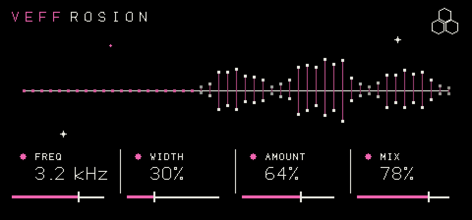
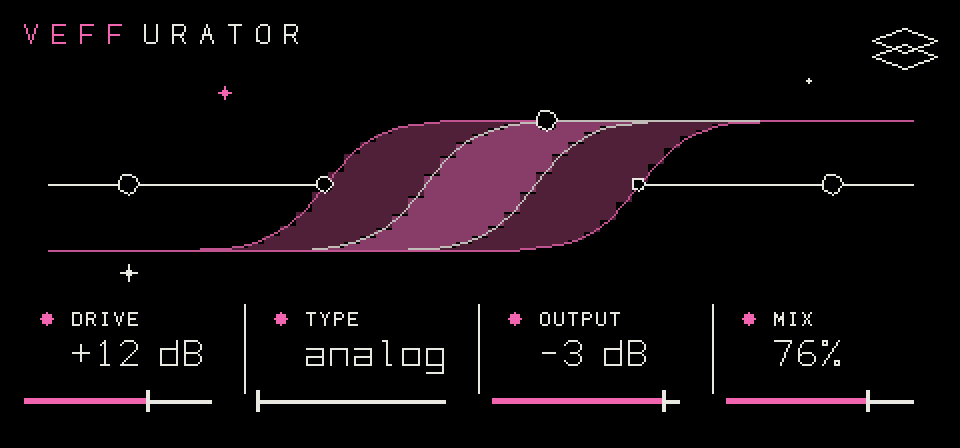
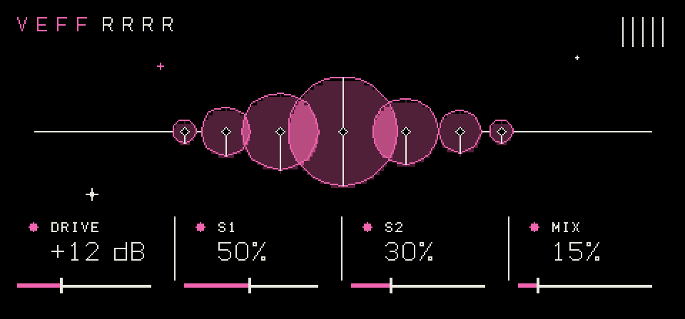

# Veff packs for open-field

Effects for the OP-1 Field, as packs for [open-field](https://github.com/LaP0573/open-field) (OS 1.7.3, base 30, level 10).

- Each effect appears in the unit's own lists of effects: shift and T3 on a sound, and the master's list on the mixer.
- Each effect also appears on every wagon of fx train.
- Every pack paints the same animated Veff page: a picture that moves with the values and the sound, and four columns with sliders.

Not affiliated with Teenage Engineering or Ableton.

Cycles are per block (64 frames, stereo), measured on a unit. The effect limit is 84,000.

| Pack | What it is | Stands on | Cycles | File |
| --- | --- | --- | --- | --- |
| veffbode | A Bode frequency shifter inside a delay's feedback loop. Knobs: shift, phase, feedback, mix. With shift held: delay (note or ms), sideband, tone, smear, cross. Starts as a jet flanger. | `delay` | ~59,000-65,000 average | [`veffbode.pack`](veffbode.pack) |
| veffrosion | A degrader in the spirit of Erosion: a 0.5 ms delay wobbled by a sine or band-passed noise. Knobs: freq, width, amount, mix. With shift held: mode (sine, noise, wide), tone. | `delay` | ~21,000 average | [`veffrosion.pack`](veffrosion.pack) |
| veffshaper | A parametric waveshaper. Knobs: drive, curve, depth, mix. With shift held: lin, damp, period, output. | `punch` | ~27,000-33,000 average | [`veffshaper.pack`](veffshaper.pack) |
| veffturator | A saturator, 2x oversampled. Knobs: drive, type (analog, sine, medium, hard, fold, digital), output, mix. With shift held: color, freq, clip, dc. | `punch` | ~54,000 average | [`veffturator.pack`](veffturator.pack) |
| veffrrrr | A two-stage distortion in serial routing. Knobs: drive, s1, s2, mix. With shift held: four sub-pages (s1, s2, fb, out); shift and a press of the 1st knob steps between them. Mix starts at 15%. | `nitro` | being measured | [`veffrrrr.pack`](veffrrrr.pack) |

## Pages

Rendered on a computer from each pack's own drawing code, at typical settings, scaled 2x.

**veffbode**


**veffrosion**



**veffshaper**


**veffturator**



**veffrrrr**



## Install

Pick a pack on the open-field install page, or copy its `.pack` into the unit's `packs` folder beside `base.pack`.

## Build

Each folder builds inside an open-field 0.12 checkout, placed at `veff/<name>/`. For example:

```bash
python3 -I tools/pack_build.py build3 --recipe veff/veffbode/recipe.json --profile profiles/op1f-1.7.3.json --out veffbode.pack
python3 -I tools/pack_build.py check --pack veffbode.pack
```

What else is in the folders:
- `veff_ui.h` is the shared page: layout, stroke font and icons. It is the same in every folder, so each pack builds on its own.
- `<name>.svg.make` is a plain black page. It stands in for the base's effect page, so the pack paints the whole screen.
- The table generators (`make_tables.py`, `gen_tables.py`) write the `*_tables.h` files.
